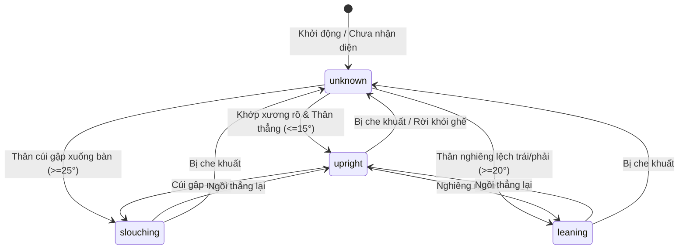

# BUSINESS.md — Nghiệp Vụ & Yêu Cầu Bài Toán

Tài liệu định nghĩa mục tiêu nghiệp vụ, bối cảnh triển khai, các trường hợp sử dụng (Use Cases) và giới hạn đạo đức/pháp lý của đồ án: **Ứng dụng IoT vào mô hình phát hiện tư thế ngồi của sinh viên trong lớp học**.

---

## 1. Bối Cảnh & Mục Tiêu Nghiệp Vụ

### 1.1. Vấn đề thực tiễn (Problem Statement)
Trong các buổi học kéo dài trên giảng đường, sinh viên thường xuyên duy trì các tư thế ngồi sai khoa học (ngồi gù lưng, cúi gập sát bàn, nghiêng vẹo cột sống sang một bên). Tình trạng này kéo dài dẫn tới:
- Tác hại cơ sinh học: Đau mỏi vai gáy, thoái hóa đốt sống cổ, vẹo cột sống học đường, giảm thị lực.
- Giảm hiệu quả tiếp thu kiến thức do lưu thông máu kém và mệt mỏi thể chất.

### 1.2. Mục tiêu giải pháp (Proposed Solution)
Xây dựng một hệ sinh thái **AIoT (AI + IoT) chi phí thấp** có khả năng:
1. Quan sát khu vực học tập qua camera không dây (ESP32-CAM).
2. Tự động nhận diện tư thế ngồi của từng vị trí ghế theo thời gian thực bằng mô hình Pose Estimation nhẹ.
3. Cảnh báo và thống kê các trạng thái ngồi sai tư thế trực quan trên Web Dashboard phục vụ sinh viên và người quản lý lớp học.
4. Bảo đảm 100% quyền riêng tư cá nhân của sinh viên theo nguyên tắc Privacy-by-Design.

---

## 2. Phân Loại Tư Thế Ngồi (Posture Taxonomy)

Hệ thống định nghĩa 4 trạng thái tư thế chuẩn hóa cho phiên bản MVP:

| Nhãn tư thế (`label`) | Định nghĩa sinh cơ học | Ngưỡng góc thân tham chiếu | Tác động sức khỏe |
| :--- | :--- | :---: | :--- |
| **`upright`** (Ngồi thẳng) | Cột sống giữ thẳng tự nhiên, đầu cân bằng trên vai, thân nghiêng không đáng kể. | $\theta_{\text{trunk}} \le 15^\circ$ | **Tích cực**: Tư thế chuẩn, tối ưu tuần hoàn và bảo vệ cột sống. |
| **`slouching`** (Gù lưng / Cúi sát bàn) | Đầu và thân trên đổ gập về phía trước mặt bàn, lưng cong tròn. | $\theta_{\text{trunk}} \ge 25^\circ$ | **Tiêu cực**: Áp lực lớn lên đốt sống cổ và thắt lưng, gây mỏi mắt. |
| **`leaning`** (Nghiêng người) | Thân người lệch hẳn sang trái hoặc phải (chống cằm, tựa người sang ghế bên). | $\theta_{\text{trunk}} \ge 20^\circ$ | **Tiêu cực**: Gây mất cân bằng cơ liên sườn, nguy cơ vẹo cột sống. |
| **`unknown`** (Không xác định) | Người rời khỏi ghế, bị đồ vật che khuất, hoặc keypoint không đủ tin cậy. | Không xác định | **Trung tính**: Không ghi nhận hành vi tư thế. |

---

## 3. Các Ca Sử Dụng Cốt Lõi (Core Use Cases)

### UC-01: Giám Sát Tư Thế Lớp Học Thời Gian Thực (Realtime Classroom Monitoring)
- **Tác nhân**: Giảng viên, Quản trị viên phòng học.
- **Kịch bản**: 
  1. Người dùng mở Web Dashboard trên máy tính hoặc màn hình giảng đường.
  2. Hệ thống tải sơ đồ các ghế ngồi (`S01`, `S02`, v.v.).
  3. Màu sắc thẻ ghế tự động đổi theo thời gian thực (Xanh lá = `upright`, Đỏ = `slouching`, Vàng = `leaning`, Xám = `unknown`).
  4. Người dùng có thể kiểm tra góc nghiêng và độ tin cậy của thuật toán tại từng ghế.

### UC-02: Phân Tích Diễn Biến Lịch Sử Buổi Học (Historical Analytics)
- **Tác nhân**: Giảng viên, Sinh viên, Nhóm nghiên cứu.
- **Kịch bản**:
  1. Người dùng chọn một mã ghế (`seat_id`) và khoảng thời gian (ví dụ từ 08:00 đến 10:00).
  2. Hệ thống truy vấn CSDL và hiển thị danh sách các sự kiện tư thế.
  3. Thống kê tỷ lệ phần trăm thời gian sinh viên ngồi đúng tư thế trong suốt buổi học.

### UC-03: Cảnh Báo Tư Thế Xấu Kéo Dài (Prolonged Bad Posture Alert)
- **Tác nhân**: Hệ thống tự động.
- **Kịch bản**:
  1. Khi một vị trí ghế liên tục duy trì nhãn `slouching` hoặc `leaning` vượt quá ngưỡng thời gian quy định (ví dụ 5 phút liên tục).
  2. Dashboard phát tín hiệu cảnh báo trực quan để nhắc nhở điều chỉnh tư thế.

---

## 4. Ranh Giới Đạo Đức & Giới Hạn Nghiệp Vụ

1. **Tuyệt đối không định danh sinh viên**:
   - Mọi bản tin, cơ sở dữ liệu và bảng hiển thị chỉ sử dụng mã vị trí ghế vật lý (`seat_id`, ví dụ: `S01`). Tuyệt đối không gắn tên, mã số sinh viên (MSSV) hay khuôn mặt.
2. **Không đánh giá đạo đức hay thái độ học tập**:
   - Nhãn tư thế là kết quả thực nghiệm từ góc đo hình học 2D. Hệ thống **không được** dùng để chấm điểm rèn luyện, xếp loại thái độ hay kết luận về sự tập trung của sinh viên.
3. **Không phải thiết bị y tế chẩn đoán**:
   - Hệ thống mang tính chất hỗ trợ nâng cao nhận thức, không thay thế các thiết bị đo kiểm y khoa chuyên dụng.
