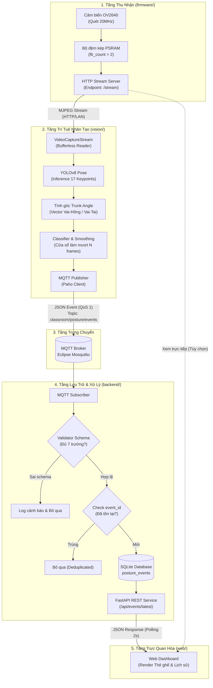
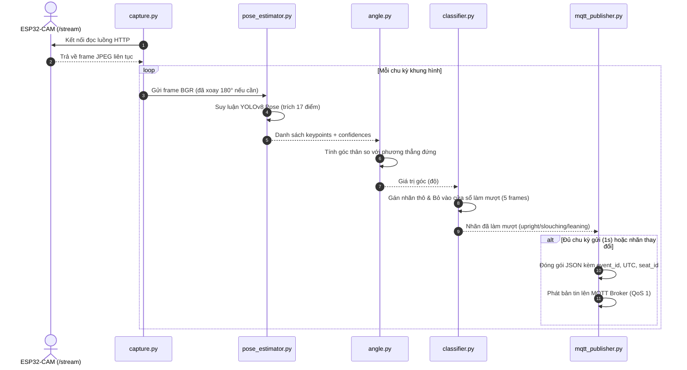
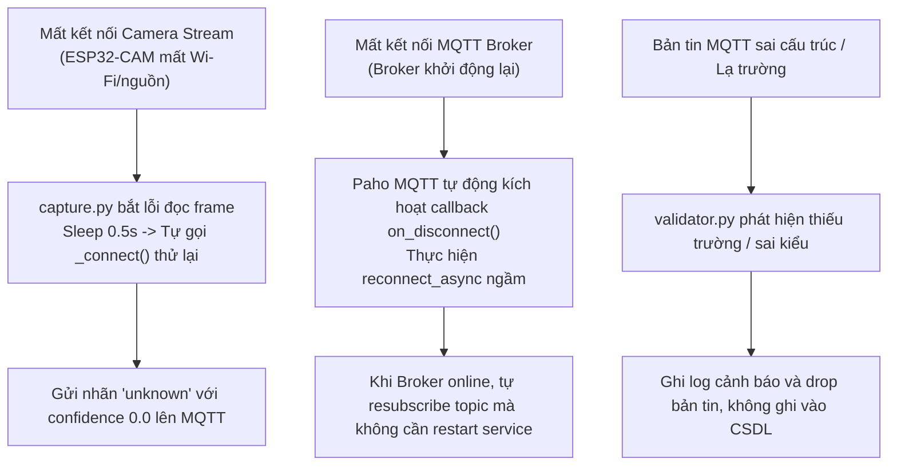

# FLOWS.md — Các Luồng Xử Lý Dữ Liệu & Tương Tác Hệ Thống

Tài liệu mô tả chi tiết toàn bộ các luồng dữ liệu (Data Flows), sơ đồ tuần tự (Sequence Diagrams) và cơ chế xử lý lỗi/phục hồi của toàn bộ hệ sinh thái IoT.

---

## 1. Sơ Đồ Kiến Trúc Luồng Dữ Liệu Tổng Thể

---

## 2. Chi Tiết Các Luồng Nghiệp Vụ Cụ Thể

### Luồng 1: Thu nhận và phát luồng video (`firmware/`)
1. ESP32-CAM khởi động, nạp cấu hình Wi-Fi từ `secrets.h`.
2. Can thiệp thanh ghi `RTC_CNTL_BROWN_OUT_REG` để vô hiệu hóa ngắt sụt áp khi phát sóng Wi-Fi công suất cao.
3. Kích hoạt PSRAM để cấp phát 2 bộ đệm khung hình DMA (`fb_count = 2`) với xung nhịp 20MHz.
4. Mở Server HTTP lắng nghe kết nối tại cổng mặc định; khi có client kết nối tới `/stream`, thiết bị truyền liên tục các frame JPEG theo định dạng `multipart/x-mixed-replace`.

### Luồng 2: Xử lý thị giác máy tính & Phân loại tư thế (`vision/`)

### Luồng 3: Tiếp nhận, xác thực và lưu trữ (`backend/`)
1. `mqtt_subscriber.py` nhận bản tin nhị phân từ topic `classroom/posture/events`.
2. Chuyển sang `validator.py`:
   - Kiểm tra định dạng JSON hợp lệ.
   - Kiểm tra bắt buộc có đủ 6 trường: `event_id`, `ts`, `seat_id`, `label`, `confidence`, `model`.
   - Kiểm tra `label` nằm trong tập hợp hợp lệ `{"upright", "slouching", "leaning", "unknown"}`.
   - Kiểm tra `confidence` nằm trong khoảng $[0.0, 1.0]$.
3. Nếu hợp lệ, gọi hàm `insert_event()` trong `database.py`:
   - Thực thi `INSERT OR IGNORE INTO posture_events ...`.
   - Nếu `event_id` đã có trong CSDL, câu lệnh tự động bỏ qua (loại bỏ lặp do QoS 1).

### Luồng 4: Hiển thị trực quan trên Web Dashboard (`web/`)
1. Client tải trang `index.html`.
2. Trình duyệt tự động kích hoạt vòng lặp polling mỗi 2 giây:
   - Gửi yêu cầu `GET /api/events/latest`.
   - Nhận danh sách trạng thái mới nhất của các ghế.
   - Cập nhật màu sắc thẻ ghế và thông số góc trên giao diện DOM.
3. Đồng thời mỗi 5 giây, gửi yêu cầu `GET /api/events?limit=20` để cập nhật bảng lịch sử sự kiện.
4. Gửi yêu cầu `GET /api/health` để cập nhật tình trạng sống của Broker và Backend.

---

## 3. Luồng Xử Lý Sự Cố & Tự Phục Hồi (Fault Tolerance Flows)

