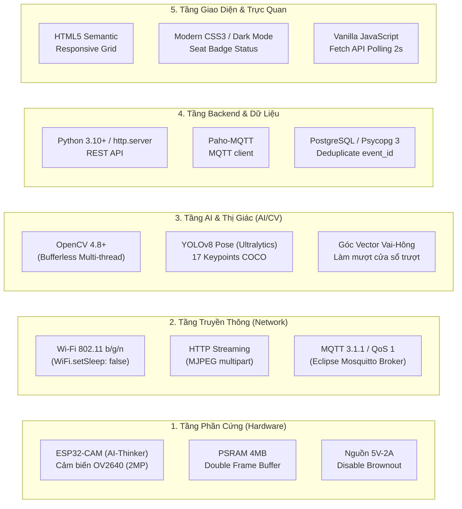

# TECHS.md — Ngăn Xếp Công Nghệ & Kiến Trúc Kỹ Thuật

Tài liệu tổng hợp toàn bộ các công nghệ, giao thức mạng, thư viện và cơ sở lý luận lựa chọn giải pháp kỹ thuật cho dự án **Giám sát tư thế ngồi trong lớp học**.

---

## 1. Bảng Tổng Hợp Ngăn Xếp Công Nghệ (Technology Stack)

---

## 2. Chi Tiết Từng Tầng Kỹ Thuật & Lý Do Lựa Chọn

### 2.1. Tầng Phần Cứng (Hardware Layer)
- **Module vi điều khiển & Camera**: **AI-Thinker ESP32-CAM (Cảm biến OmniVision OV2640 2 Megapixel)**.
  - Tài liệu này không ghi giá hoặc kết quả hiệu năng phần cứng vì chưa có phép đo/nguồn được xác nhận cho môi trường demo.
  - *Kỹ thuật tối ưu đã áp dụng*:
    - Xung nhịp cảm biến tăng lên **20MHz** (`xclk_freq_hz = 20000000`) để quét frame nhanh nhất.
    - Cấp phát 2 bộ đệm khung hình DMA (`fb_count = 2`, chế độ `CAMERA_GRAB_LATEST`) cho phép vừa truyền frame này qua mạng vừa thu nhận frame tiếp theo.
    - Tắt thanh ghi Brownout detector để chống sập nguồn khi dòng phát Wi-Fi đạt đỉnh 500mA.
  - Độ phân giải và FPS mặc định vẫn chờ đo/chốt theo D-09; chưa có kết quả đo được ghi tại đây.

### 2.2. Tầng Truyền Thông Mạng (Network & Protocols)
- **Wi-Fi**: Chuẩn 802.11 b/g/n; độ trễ thực tế chưa được đo.
- **Truyền video (Camera → AI)**: **MJPEG qua HTTP Streaming**.
  - ESP32-CAM phát MJPEG; OpenCV có thể đọc HTTP stream. Độ trễ và mức sử dụng tài nguyên chưa được đo.
- **Truyền bản tin sự kiện (AI → Backend)**: **MQTT 3.1.1 (Broker Eclipse Mosquitto)**.
  - *Lý do chọn*: Kiến trúc Publish/Subscribe tách biệt hoàn toàn module Vision và Backend. Băng thông cực nhẹ (gói JSON ~200 bytes), hỗ trợ QoS 1 đảm bảo không mất sự kiện khi mạng lớp học chập chờn.

### 2.3. Tầng Thị Giác Máy Tính & Trí Tuệ Nhân Tạo (AI / CV)
- **Thư viện nền tảng**: **OpenCV (Python)** với kiến trúc đọc đa luồng (Bufferless Threading) ngăn chặn việc video bị tích luỹ trong hàng đợi gây trễ hình.
- **Mô hình Pose Estimation**: **YOLOv8 Pose (Ultralytics - `yolov8n-pose.pt`)**.
  - Cấu hình hiện đặt model `yolov8n-pose.pt`; tốc độ suy luận và độ chính xác chưa được đo trên thiết bị demo.
- **Thuật toán phân loại**:
  - Tính góc nghiêng thân $\theta = \arctan\left(\frac{|\Delta x|}{|\Delta y|}\right) \times \frac{180}{\pi}$ từ trung điểm vai tới trung điểm hông so với phương thẳng đứng.
  - Bộ lọc làm mượt thời gian (Temporal Majority Voting) dùng cửa sổ cấu hình trong `vision/config.yaml`; góc không tính được trả nhãn `unknown` thay vì giữ nhãn cũ.

### 2.4. Tầng Dữ Liệu & Backend (Backend & Data Layer)
- **Ngôn ngữ & HTTP server**: **Python 3.10+ và `http.server.ThreadingHTTPServer`**.
  - API hiện đăng ký `GET /api/events/latest` và `GET /api/events`; không có `/api/health`.
- **Cơ sở dữ liệu**: **PostgreSQL với Psycopg 3** (D-07 đã chốt).
  - Bảng `posture_events` được tạo qua migrations. Repository chèn bằng `INSERT ... ON CONFLICT (event_id) DO NOTHING RETURNING event_id` để loại event trùng.

### 2.5. Tầng Giao Diện Người Dùng (Frontend Dashboard)
- **Công nghệ**: **HTML5, CSS3, Vanilla JavaScript**. Dashboard polling REST API theo chu kỳ 2 giây hiện được đặt trong `web/app.js`.

### 2.6. Tầng Tự Động Hóa & DevOps (DevOps & Testing)
- **Docker & Docker Compose**: Đóng gói sẵn dịch vụ Eclipse Mosquitto MQTT Broker.
- **Testing Framework**: `pytest` cho unit test logic validator và classifier.
- **CI/CD**: **GitHub Actions** tự động chạy test và quét lộ mật khẩu/secret trên mọi Pull Request.

---

## 3. Danh Mục Thư Viện & Phiên Bản Chuẩn (Dependencies)

| Tên thư viện | Phiên bản tối thiểu | Vị trí sử dụng | Mục đích |
| :--- | :--- | :--- | :--- |
| `ultralytics` | `>= 8.0.0` | `vision/` | Mô hình YOLOv8 Pose |
| `opencv-python` | `>= 4.8.0` | `vision/` | Đọc video, xử lý hình ảnh |
| `paho-mqtt` | `>= 1.6.1` | `vision/`, `backend/`, `tests/` | MQTT Publisher / Subscriber |
| `psycopg` | `>= 3` | `backend/` | Kết nối PostgreSQL |
| `pytest` | `>= 7.0.0` | `tests/` | Unit testing tự động |
