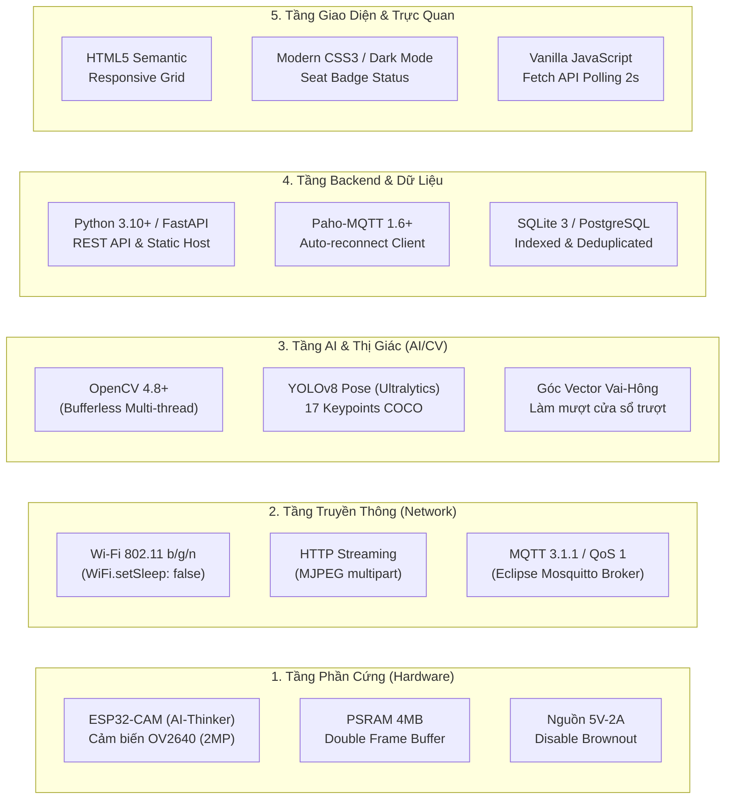

# TECHS.md — Ngăn Xếp Công Nghệ & Kiến Trúc Kỹ Thuật

Tài liệu tổng hợp toàn bộ các công nghệ, giao thức mạng, thư viện và cơ sở lý luận lựa chọn giải pháp kỹ thuật cho dự án **Giám sát tư thế ngồi trong lớp học**.

---

## 1. Bảng Tổng Hợp Ngăn Xếp Công Nghệ (Technology Stack)

---

## 2. Chi Tiết Từng Tầng Kỹ Thuật & Lý Do Lựa Chọn

### 2.1. Tầng Phần Cứng (Hardware Layer)
- **Module vi điều khiển & Camera**: **AI-Thinker ESP32-CAM (Cảm biến OmniVision OV2640 2 Megapixel)**.
  - *Lý do chọn*: Giá thành rất rẻ (~100.000 VNĐ), tích hợp sẵn Wi-Fi và Bluetooth, có bộ nhớ PSRAM ngoài 4MB đủ sức chạy bộ đệm ảnh kép.
  - *Kỹ thuật tối ưu đã áp dụng*:
    - Xung nhịp cảm biến tăng lên **20MHz** (`xclk_freq_hz = 20000000`) để quét frame nhanh nhất.
    - Cấp phát 2 bộ đệm khung hình DMA (`fb_count = 2`, chế độ `CAMERA_GRAB_LATEST`) cho phép vừa truyền frame này qua mạng vừa thu nhận frame tiếp theo.
    - Tắt thanh ghi Brownout detector để chống sập nguồn khi dòng phát Wi-Fi đạt đỉnh 500mA.
  - *Độ phân giải & FPS*: VGA (640x480) hoặc CIF (400x296), chất lượng nén JPEG mức 12 đạt tốc độ 20–30 FPS ổn định.

### 2.2. Tầng Truyền Thông Mạng (Network & Protocols)
- **Wi-Fi**: Chuẩn 802.11 b/g/n, chế độ không ngủ (`WiFi.setSleep(false)`) giữ độ trễ truyền gói tin dưới 30ms.
- **Truyền video (Camera → AI)**: **MJPEG qua HTTP Streaming**.
  - *Lý do chọn*: ESP32-CAM phát MJPEG tiêu thụ rất ít RAM/CPU (không cần thuật toán nén H.264 phức tạp), độ trễ dưới 50ms, trình duyệt và OpenCV đọc trực tiếp được mà không cần cài thêm driver.
- **Truyền bản tin sự kiện (AI → Backend)**: **MQTT 3.1.1 (Broker Eclipse Mosquitto)**.
  - *Lý do chọn*: Kiến trúc Publish/Subscribe tách biệt hoàn toàn module Vision và Backend. Băng thông cực nhẹ (gói JSON ~200 bytes), hỗ trợ QoS 1 đảm bảo không mất sự kiện khi mạng lớp học chập chờn.

### 2.3. Tầng Thị Giác Máy Tính & Trí Tuệ Nhân Tạo (AI / CV)
- **Thư viện nền tảng**: **OpenCV (Python)** với kiến trúc đọc đa luồng (Bufferless Threading) ngăn chặn việc video bị tích luỹ trong hàng đợi gây trễ hình.
- **Mô hình Pose Estimation**: **YOLOv8 Pose (Ultralytics - `yolov8n-pose.pt`)**.
  - *Lý do chọn*: Phiên bản Nano cực nhẹ (~6MB), tốc độ suy luận nhanh (30+ FPS trên GPU phổ thông, 10–15 FPS trên CPU), nhận diện đồng thời nhiều sinh viên trong cùng 1 khung hình tốt hơn MediaPipe đơn người.
- **Thuật toán phân loại**:
  - Tính góc nghiêng thân $\theta = \arctan\left(\frac{|\Delta x|}{|\Delta y|}\right) \times \frac{180}{\pi}$ từ trung điểm vai tới trung điểm hông so với phương thẳng đứng.
  - Bộ lọc làm mượt thời gian (Temporal Majority Voting) trên cửa sổ 5 khung hình liên tiếp để lọc nhiễu giật nhãn do rung lắc khung xương.

### 2.4. Tầng Dữ Liệu & Backend (Backend & Data Layer)
- **Ngôn ngữ & Framework**: **Python 3.10+ kết hợp FastAPI & Uvicorn**.
  - *Lý do chọn*: Xử lý bất đồng bộ (Async I/O) hiệu năng cao, tự động sinh tài liệu Swagger UI chuẩn (`/docs`), tích hợp liền mạch với Paho-MQTT.
- **Cơ sở dữ liệu**: **SQLite 3** (mặc định) / **PostgreSQL** (mở rộng).
  - *Lý do chọn*: SQLite lưu gọn trong file `backend/posture.db`, không phụ thuộc daemon, có chỉ mục kép B-Tree (`idx_posture_ts`, `idx_posture_seat_ts`) cho tốc độ truy vấn mili-giây.

### 2.5. Tầng Giao Diện Người Dùng (Frontend Dashboard)
- **Công nghệ**: **HTML5, Modern CSS3 (Grid/Flexbox, Dark theme), Vanilla JavaScript**.
  - *Lý do chọn*: Không cần build tool nặng nề (Webpack/Vite), tải trang tức thì, dễ dàng tùy biến thẻ ghế trực quan, cập nhật dữ liệu tự động bằng Polling REST API mỗi 2 giây.

### 2.6. Tầng Tự Động Hóa & DevOps (DevOps & Testing)
- **Docker & Docker Compose**: Đóng gói sẵn dịch vụ Eclipse Mosquitto MQTT Broker.
- **Testing Framework**: `pytest` cho unit test logic validator và classifier.
- **CI/CD**: **GitHub Actions** tự động chạy test và quét lộ mật khẩu/secret trên mọi Pull Request.

---

## 3. Danh Mục Thư Viện & Phiên Bản Chuẩn (Dependencies)

| Tên thư viện | Phiên bản tối thiểu | Vị trí sử dụng | Mục đích |
| :--- | :--- | :--- | :--- |
| `ultralytics` | `>= 8.0.0` | `vision/` | Mô hình YOLOv8 Pose |
| `opencv-python` | `>= 4.8.0` | `vision/` | Đọc video, xử lý hình ảnh |
| `paho-mqtt` | `>= 1.6.1` | `vision/`, `backend/`, `tests/` | MQTT Publisher / Subscriber |
| `fastapi` | `>= 0.100.0` | `backend/` | REST API service |
| `uvicorn` | `>= 0.23.0` | `backend/` | ASGI Server chạy FastAPI |
| `pydantic` | `>= 2.0.0` | `backend/` | Kiểm tra dữ liệu API |
| `pytest` | `>= 7.0.0` | `tests/` | Unit testing tự động |
